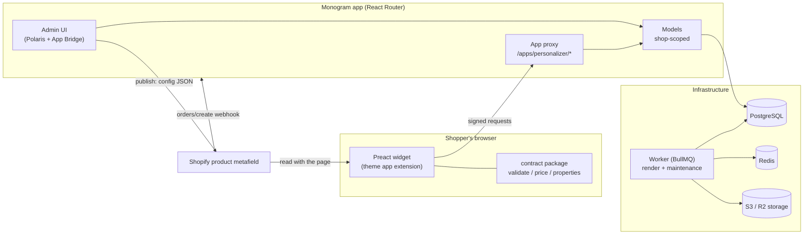

<div align="center">

# Monogram

**Let shoppers make it theirs.**
A Shopify app for product personalization: form options, live preview, price add-ons, and print-ready files.


</div>

---

## What it does

A shopper opens a product page, types a name, picks a font and metal, drops in a photo, or builds a six-slot monogram. They see the result on the product photo as they go. The price updates live. When they check out, the merchant receives the exact files needed to produce the item.

Monogram ships in two editions that share one engine:

| | **Options edition** | **Designer edition** |
|---|---|---|
| For | Engraved, embroidered, printed-to-order products | Print-on-demand, multi-view products |
| Shopper sees | Option form + simple live preview | Templates, multiple views, curved text, crop |
| Merchant gets | Properties on the order + preview PNG | Print-ready PNG / SVG, proof PDF, thread sheet |
| Status | **In progress** (Phase 1) | Planned (Phase 2) |

### Highlights

- **11 option types today:** text, textarea, number, dropdown, radio, checkbox, swatch, font picker, clipart, **slots** (ordered text / letter / icon placements) and upload. Date and hidden fields are planned for Phase 2.
- **Conditions:** show or hide options and even single values from other answers or the selected variant. Cycles are rejected at publish.
- **Pricing on every Shopify plan** through a hidden fee product, with a server-side checkout guard so prices can't be tampered with in the browser. Optional Cart Transform mode for eligible plans.
- **One brain, two runtimes.** The same `validate` / `priceFor` / `toLineProperties` code runs in the shopper's browser and on the server, and weighs about **3.7 KB gzipped** in the storefront bundle.
- **No theme edits.** The storefront ships only as a theme app extension (app block + app embed).
- **Old orders never break.** Every publish writes an immutable version snapshot; designs reference a version.

---

## Status

Monogram is being built task by task from a written spec (`personalizer-spec/`). Progress against the roadmap:

| Phase | Scope | Done |
|---|---|---|
| **1 · MVP** (Options edition) | T01–T23 | **3 / 23** |
| 2 · Designer | T24–T30 | 0 / 7 |
| 3 · Public app | T31–T38 | 0 / 8 |

- [x] **T01** Scaffold: React Router app, npm workspaces, Postgres, Redis + BullMQ worker, theme app extension, app-proxy health route, CI
- [x] **T02** Data model: Prisma schema, shop-scoped models, dev seed with 3 starter option sets, nightly upload cleanup
- [x] **T03** Contract: shared types + zod schemas, `visibleOptions`, `validate`, `priceFor`, `toLineProperties`, `validateOptionSet` (100% covered)
- [ ] **T04–T08** Admin: option set list, builder, conditions and pricing tabs, publish, libraries
- [ ] **T09–T14** Storefront widget, uploads, design save and submit guard
- [ ] **T15–T16** Layout engine and live preview
- [ ] **T17–T18** Fee product and checkout guard function
- [ ] **T19–T23** Orders, rendering, onboarding, security, theme matrix

See [`personalizer-spec/12-roadmap-tasks.md`](personalizer-spec/12-roadmap-tasks.md) for the full plan.

---

## Architecture



**How a config travels.** The merchant edits a draft in the admin. On publish it is validated, snapshotted as an immutable version, and written to a product metafield. The storefront reads it with the page, so the form renders without waiting on any API call. After an order, a worker renders the preview and print files from the saved design.

---

## Repository layout

```
.
├─ app/                        Shopify app (React Router): admin, proxy, webhooks
│  ├─ models/                  shop-scoped data access + starter option sets + seed
│  └─ routes/                  proxy.health, auth, webhooks
├─ extensions/
│  └─ personalizer-theme/      theme app extension: app block + app embed
├─ packages/
│  ├─ contract/                shared types, zod schemas, validate/price/properties
│  ├─ layout/                  layout engine (browser + node)            [planned]
│  └─ widget/                  Preact storefront source, built with esbuild
├─ worker/                     BullMQ worker: render queue, nightly cleanup
├─ prisma/                     schema, migrations, seed entry
├─ test/                       shared test DB setup
├─ docs/                       decisions.md, changelog.md
└─ personalizer-spec/          the build spec this project follows
```

> **Naming.** The product is **Monogram**. Internal package and folder names still use the working name `personalizer`; only the Shopify app name and storefront labels need to change at launch.

---

## Quick start

**Prerequisites:** Node 22.12+, npm, Docker (or any container runtime), a [Shopify Partner](https://partners.shopify.com) account and a development store.

```bash
git clone https://github.com/siraajul/Monogram.git
cd Monogram

cp .env.example .env            # fill SHOPIFY_API_KEY / SHOPIFY_API_SECRET after linking
docker compose up -d            # Postgres on :5433, Redis on :6380
npm install
npm run setup                   # prisma generate + migrate
npm run db:seed                 # dev shop + 3 starter option sets
npm run config:link             # link to your Shopify app (opens a login)
npm run build:widget            # writes the extension's JS/CSS assets
npm run dev                     # shopify app dev: tunnel, install on dev store
```

In a second terminal, start the worker:

```bash
npm run dev:worker              # PING_ON_START=1 npm run dev:worker enqueues a test job
```

> `npm install` blocks install scripts by default on npm 11. The needed ones (`prisma`, `@prisma/client`, `@prisma/engines`, `esbuild`) are pre-approved in `package.json` under `allowScripts`.

### Starter option sets (seeded)

| Set | Shows off |
|---|---|
| **Name necklace** | letters-only text, font picker, metal swatches, a "second name" checkbox (+$10) that reveals another field via a condition |
| **Monogram tote** | six-slot builder (text / letter / icon), 12 thread colours, 12 demo icons |
| **Photo gift** | JPG/PNG upload up to 15 MB, caption (max 30), +$5 fee |

---

## The contract package

Everything the admin, storefront, worker and API exchange is defined once in [`packages/contract`](packages/contract), as TypeScript types and zod schemas, plus the logic that must behave identically in the browser and on the server.

```ts
import { validate, priceFor, toLineProperties, visibleOptions } from "@personalizer/contract";

const errors = validate(config, answers, variantGid);      // [{ optionId, code, message }]
const extra  = priceFor(config, answers, variantGid);      // 10  (shop currency, major units)
const props  = toLineProperties(config, answers, {         // → cart line item properties
  variantGid, designId, token, group,
});
// {
//   Name: "Maya", Font: "Script", Metal: "Gold",
//   "Placement 1": "Text: PICKLE (Block, Green)",
//   _design_id: "…", _set: "ckx…:v3", _group: "…"
// }
```

Rules worth knowing:

- A hidden option is **not validated, not priced and not sent to the cart**.
- A matching `hide` condition always beats a matching `show`.
- Optional means skippable: an empty optional option is never an error, but once filled all its rules apply.
- Per-font rules (for example "Script allows only 4 characters") follow the font the shopper picked.
- Text is trimmed and transformed before validation, pricing and output, so all three always agree.

The full semantics are written down in [`docs/decisions.md`](docs/decisions.md).

---

## Scripts

| Command | What it does |
|---|---|
| `npm run dev` | Run the app on your dev store (`shopify app dev`) |
| `npm run dev:worker` | Run the BullMQ worker with file watching |
| `npm run build:widget` | Build the storefront widget into the theme extension |
| `npm run dev:widget` | Same, in watch mode |
| `npm run check:bundle-size` | Fail if `personalizer.js` is over 60 KB gzipped |
| `npm run db:seed` | Seed the dev shop and starter option sets (idempotent) |
| `npm test` | All tests (needs Postgres; creates its own `_test` database) |
| `npm run coverage` | Contract tests with a hard 100% coverage gate |
| `npm run typecheck` · `npm run lint` | Typecheck and lint every workspace |

### Quality gates

CI runs on every pull request: Prisma validate and migrate, typecheck, lint, unit and database tests, the **100% coverage gate** on the contract logic, the **60 KB widget budget**, and production builds of the app and worker. Tests use a real Postgres, never mocks.

---

## Tech stack

| Layer | Choice |
|---|---|
| App | Shopify React Router template, TypeScript (strict) |
| Admin UI | Polaris + App Bridge |
| Storefront | Preact, bundled with esbuild into a theme app extension |
| Database | PostgreSQL 15+ with Prisma |
| Queue | BullMQ + Redis |
| Preview canvas | Konva *(planned)*; Fabric.js for the Designer template editor *(planned)* |
| Server rendering | @napi-rs/canvas, opentype.js, resvg-js, pdf-lib, sharp *(planned)* |
| Storage | S3-compatible (Cloudflare R2 or AWS S3) |
| Validation | zod |
| Tests | Vitest (Playwright for the theme matrix, planned) |

---

## Security and privacy by design

- Every query is scoped by shop. A shop can never read, update or publish another shop's data (covered by tests).
- Shopper text is length-checked **before** any merchant-supplied regex runs on it.
- Prices are enforced at checkout by a server-side validation function, not trusted from the browser *(T18)*.
- Uploads are designed to expire after 30 days unless an order uses them. The nightly cleanup job is built; the upload endpoints that set the expiry arrive in T13.
- No secrets in the repo: `.env` is git-ignored and `.env.example` documents every variable.

---

## Documentation

| | |
|---|---|
| [`personalizer-spec/`](personalizer-spec) | The build spec, split into 13 parts (setup, data model, contract, admin, widget, preview, pricing, rendering, API, billing/security, testing, roadmap) |
| [`docs/decisions.md`](docs/decisions.md) | Every place the spec was ambiguous and how it was resolved |
| [`docs/changelog.md`](docs/changelog.md) | What each task delivered |

---

## Contributing

Work is organised in the numbered tasks of the roadmap. Each task ends with code, tests and a changelog entry, and nothing starts before the previous task's acceptance checks pass. Keep the storefront bundle under 60 KB gzipped, and record any new decision in `docs/decisions.md`.

## License

Not yet chosen. Until a license is added, all rights are reserved.
